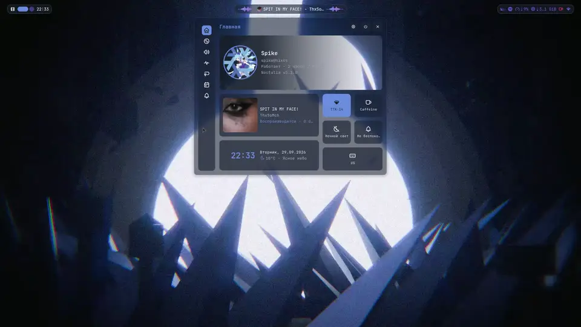
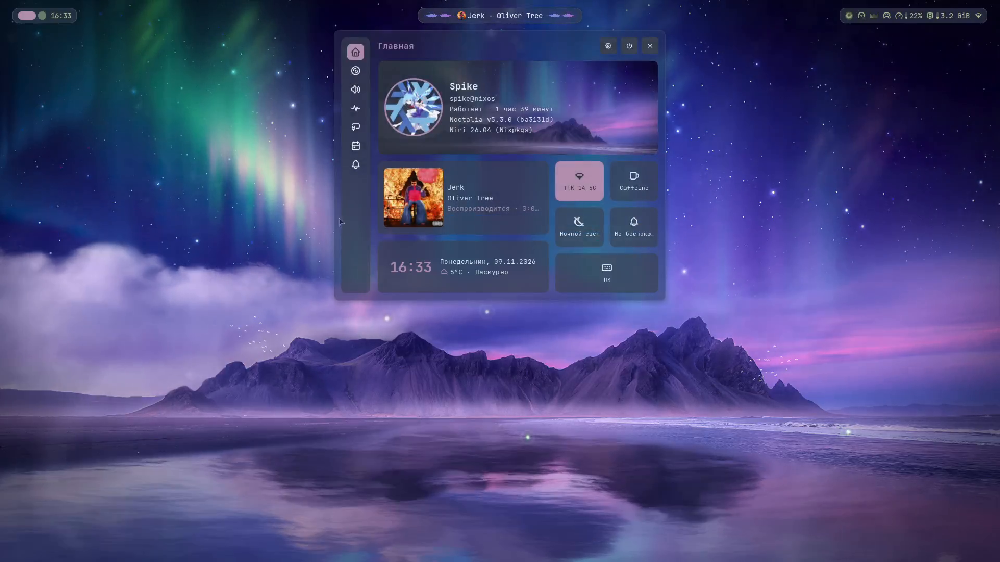
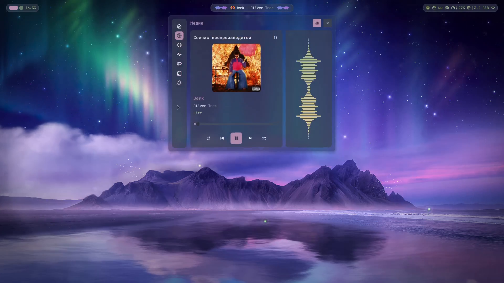
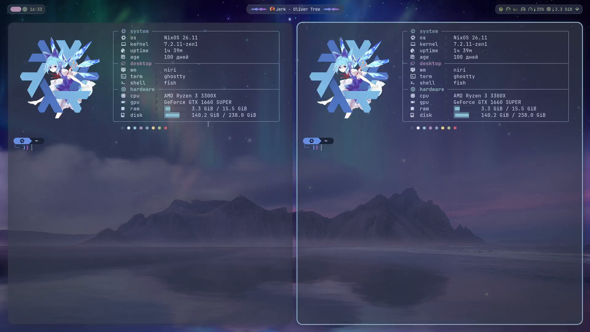
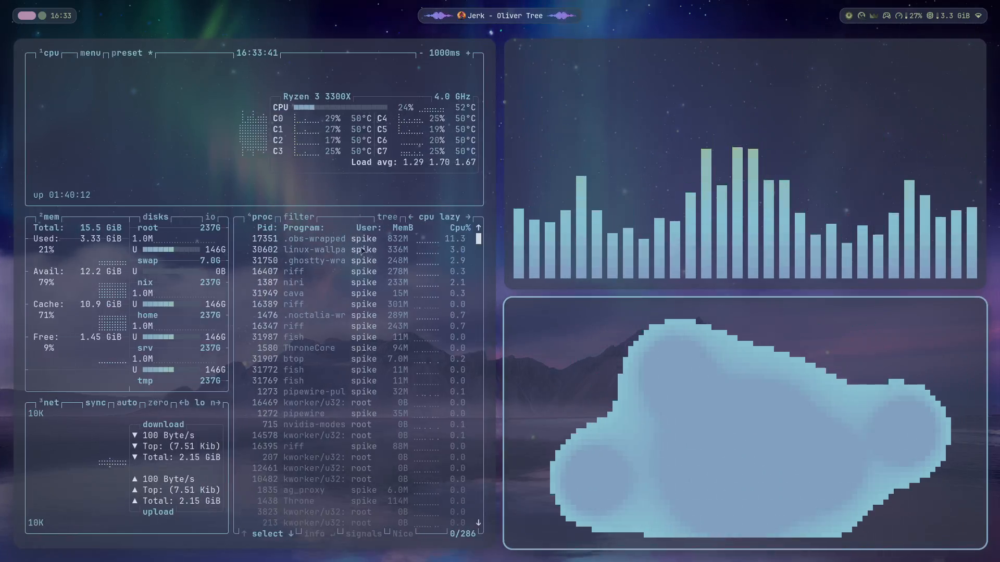
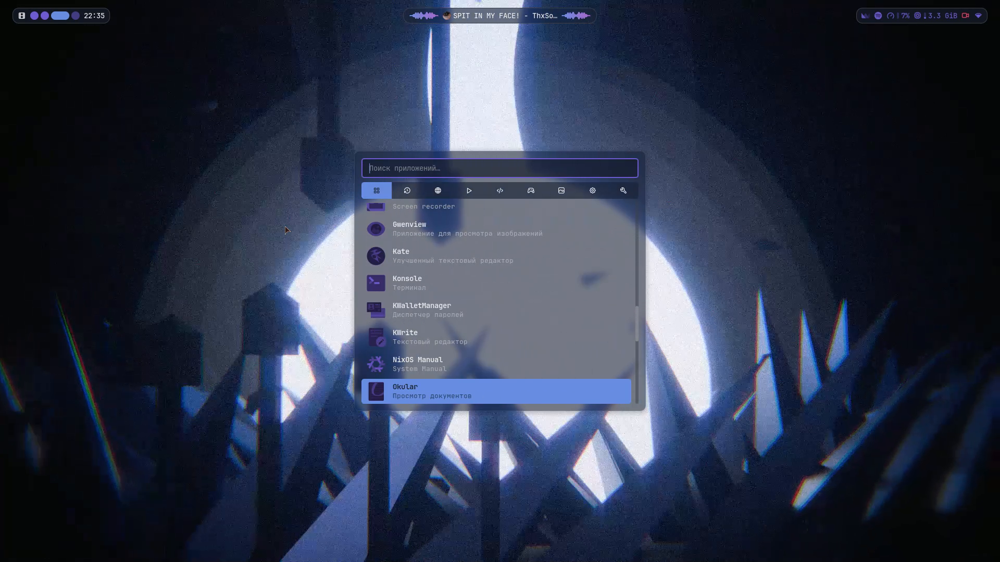

# Spike-dotfiles 🌌

<div align="center">

[](https://nixos.org/)
[](https://github.com/YaLTeR/niri)
[](https://github.com/noctalia-dev/noctalia)
[](https://ghostty.org/)
[](https://nixos.wiki/wiki/Flakes)
<br/>
[](https://github.com/triplespike/Spike-dotfiles/stargazers)
[](https://github.com/triplespike/Spike-dotfiles/network/members)
[](https://github.com/triplespike/Spike-dotfiles/commits/master)
[](LICENSE)
[](https://www.reddit.com/r/unixporn/comments/1wtkorx/niri_my_first_rice_on_nixos_x_noctalia/)

*A dark cosmic / cyberpunk daily-driver rice on NixOS featuring the Niri scroll-compositor and Noctalia shell, inspired by the Nullscapes aesthetic.*

<br/>

[](assets/showcase.mp4)

<sub>✨ *Click preview to watch the full 1080p 60fps video with audio, or join the [Reddit Discussion](https://www.reddit.com/r/unixporn/comments/1wtkorx/niri_my_first_rice_on_nixos_x_noctalia/)* ✨</sub>

</div>

---

> [!WARNING]
> ### ⚠️ Please Read Before Using!
> 
> * **First Rice & Beginner Notice:** This is my very first rice and my first public dotfiles repo, shared after posting on [r/unixporn](https://www.reddit.com/r/unixporn/comments/1wtkorx/niri_my_first_rice_on_nixos_x_noctalia/). I'm still learning NixOS, so this configuration is tailored specifically to my personal daily machine.
> * **DO NOT blindly run `nixos-rebuild switch`:** This repository is **NOT an automated installer** or a universal turn-key OS template. Applying someone else's system configuration directly onto your machine can break your boot, display drivers, or graphical session.
> * **Hardware-Specific Environment:** These dotfiles are specifically tuned for an **NVIDIA GPU** (proprietary drivers + Wayland buffer limits), AMD CPU, and a single 1080p @ 75Hz display.
> * **No Warranty & No Tech Support:** Everything here is provided strictly **AS-IS**. I take zero responsibility for broken setups, and I cannot provide personal tech support or triage GitHub issues for different hardware or distributions.
> * **Recommended Approach — Cherry-pick! 🍒:** The best way to use these dotfiles is to browse the configs, take inspiration, and cherry-pick what you like (Noctalia capsule blur, Niri keybindings, Ghostty/Fish styling, Fastfetch art, or Satty screenshot pipeline) into your own existing system!

---

## ✨ Key Highlights & Features

* ⚡ **Zero-Latency Direct-Scanout for Gaming:** Custom Niri window rules targeting Steam games and Geometry Dash (`steam_app_*`, `geometrydash`). Automatically disables rounded borders, disables shadows, and enables uninhibited fullscreen direct scanout for zero compositor input delay.
* 🌀 **Niri Infinite Horizontal Canvas:** Smooth, physics-based horizontal scrolling tiling compositor. Window widths adjust dynamically with hotkeys (`Mod+R`), keeping your active workspace uncluttered.
* 💊 **Native C++ Capsule Blur Patch:** Includes a dedicated nixpkgs `overrideAttrs` patch ([`patches/noctalia-bar-capsule-blur.patch`](patches/noctalia-bar-capsule-blur.patch)) for Noctalia shell, injecting native capsule background blur into the bar.
* 🌌 **Live Animated Wallpaper (W-Engine):** Seamless integration with Wallpaper Engine (`linux-wallpaperengine` running *Nullscapes - No Text* by Kiba) tuned for 30 FPS at minimal CPU/RAM footprint (~360MB).
* 🛡️ **NVIDIA Wayland Stability Rules:** Declarative NVIDIA buffer pool limit configuration (`50-limit-free-buffer-pool-in-wayland-compositors.json`) eliminating stutter and frame drops on proprietary NVIDIA drivers.
* 🎵 **Cohesive Audio & Spicetify:** PipeWire + WirePlumber software mixer volume curve paired with Spotify customized via Spicetify in a matching Catppuccin / Tokyo Night dark palette.
* ❄️ **100% Declarative Flake Architecture:** Reproducible, immutable system and user environment managed via Nix Flakes and Home Manager with atomic rollbacks.

---

## 🎨 Color Palette

Crafted around deep cosmic voids (`#080B16`) with electric lavender, mauve, and neon coral accents:

| Role | Swatch | Hex Code | Description |
| :--- | :---: | :--- | :--- |
| **Deep Void** | `` | `#080B16` | Root background & dark surfaces |
| **Surface Elevated** | `` | `#141B29` | Cards, popups, and elevated UI blocks |
| **Highlight Surface** | `` | `#1B2437` | Hover states, tab backgrounds, notifications |
| **Electric Lavender / Blue** | `` | `#678FE4` | Primary accent, focused borders, Noctalia capsules |
| **Cosmic Mauve** | `` | `#AB66CC` | Secondary accent, button actives |
| **Mint Cyan** | `` | `#79B9B5` | Terminal green/cyan, success states |
| **Neon Coral** | `` | `#FD4663` | Terminal red, error notifications, Fastfetch art |
| **Ghost White** | `` | `#E8EDFF` | High-contrast readable foreground text |

---

## 📸 Screenshots Gallery

<details open>
<summary><b>Click to expand / collapse screenshots</b></summary>
<br/>

| Clean Desktop (Wallpaper & Noctalia Bar) | Noctalia Control Center & Sliders |
| :---: | :---: |
| [](assets/screenshots/01_desktop.png) | [](assets/screenshots/02_control_center.png) |

| Ghostty & Fastfetch | Cava Audio Visualizer & Btop |
| :---: | :---: |
| [](assets/screenshots/03_terminal.png) | [](assets/screenshots/04_cava_btop.png) |

<div align="center">

### Noctalia App Launcher
[](assets/screenshots/05_launcher.png)

</div>

</details>

---

## 🎨 Aesthetic & Rice Overview

| Component | Software / Details |
| :--- | :--- |
| **OS** | [NixOS](https://nixos.org/) (Unstable channel, Linux Zen kernel) |
| **Compositor** | [Niri](https://github.com/YaLTeR/niri) (Scrollable-tiling Wayland compositor) |
| **Shell & Bar** | [Noctalia](https://github.com/noctalia-dev/noctalia) (Custom C++ capsule blur patch included) |
| **Terminal** | [Ghostty](https://ghostty.org/) (Nullscapes deep cosmic palette) |
| **Shell** | [Fish](https://fishshell.com/) + [Starship](https://starship.rs/) prompt |
| **Fetch** | [Fastfetch](https://github.com/fastfetch-cli/fastfetch) with bundled art (`assets/fastfetch/Easy.png`) |
| **Launcher** | [Fuzzel](https://codeberg.org/dnkl/fuzzel) & Noctalia App Launcher |
| **Screenshots** | [Satty](https://github.com/gabm/Satty) with instant screen freeze via Noctalia screencopy |
| **Display Manager** | SDDM with [Astronaut theme](https://github.com/keyitdev/sddm-astronaut-theme) (Black Hole preset) |
| **Bootloader** | GRUB with [HyperFluent theme](https://github.com/Coopydood/HyperFluent-GRUB-Theme) |
| **Audio** | PipeWire + WirePlumber (software mixer volume curve) |
| **Cursor** | Catppuccin Mocha Dark |

---

## 🖼️ Wallpaper

The live animated wallpaper shown in the showcase video is from **Wallpaper Engine**:
* **Steam Workshop:** [Nullscapes - Wallpaper (No Text) by Kiba](https://steamcommunity.com/sharedfiles/filedetails/?id=3741021206) (Workshop ID: `3741021206`).
* A high-resolution static version is included in this repository: [`assets/wallpapers/nullscapes.png`](assets/wallpapers/nullscapes.png).

---

## ⌨️ Keybindings Cheatsheet

| Keybinding | Action |
| :--- | :--- |
| `Mod + Return` | Spawn Terminal ([Ghostty](https://ghostty.org/)) |
| `Mod + D` | Application Launcher ([Fuzzel](https://codeberg.org/dnkl/fuzzel)) |
| `Mod + E` | File Manager ([Dolphin](https://apps.kde.org/dolphin/)) |
| `Mod + B` | Web Browser ([Firefox](https://www.mozilla.org/firefox/)) |
| `Mod + M` | Music Player ([Spotify / Spicetify](https://spicetify.app/)) |
| `Mod + Q` | Close Active Window |
| `Mod + Space` | Toggle Keyboard Layout (`US` ↔ `RU`) |
| `Print` | Capture Screenshot (Freeze screen + [Satty](https://github.com/gabm/Satty) annotation) |
| `Mod + H / L` | Focus Column Left / Right |
| `Mod + J / K` | Focus Window Down / Up |
| `Mod + Shift + H / L` | Move Column Left / Right |
| `Mod + Shift + J / K` | Move Window Down / Up |
| `Mod + R` | Switch Preset Column Width (e.g. 50% ↔ 75% ↔ 100%) |
| `Mod + F` | Maximize Column |
| `Mod + Shift + F` | Fullscreen Window (Direct Scanout) |
| `Mod + 1..9` | Switch to Workspace 1–9 |
| `XF86Audio*` | Volume up / down / mute (with Noctalia OSD) |
| `XF86MonBrightness*`| Screen brightness up / down (with Noctalia OSD) |

---

## 🚀 Structure & How to Explore

```
Spike-dotfiles/
├── assets/
│   ├── fastfetch/Easy.png      # Fastfetch anime art logo
│   ├── screenshots/            # Showcase screenshots
│   ├── wallpapers/nullscapes.png # High-res static wallpaper
│   ├── showcase.webp           # Looping animated preview
│   └── showcase.mp4            # Full 2-minute showcase video
├── patches/
│   └── noctalia-bar-capsule-blur.patch # C++ patch for rounded capsule blur in Noctalia
├── configuration.nix           # System-level NixOS configuration
├── flake.nix                   # Flake inputs & system declaration
├── hardware-configuration.nix.example # Hardware config template
├── home.nix                    # Home Manager: Niri, Noctalia, Ghostty, Fish, Themes
├── LICENSE                     # MIT License
└── README.md                   # Project documentation
```

### If you want to adapt this to your own system:
1. **Never copy wholesale without checking hardware**:
   Generate your own hardware config:
   ```bash
   sudo nixos-generate-config --show-hardware-config > hardware-configuration.nix
   ```
2. **Review `configuration.nix`**:
   Adjust your video drivers (`services.xserver.videoDrivers`), username, and timezone.
3. **Review `home.nix`**:
   Adjust monitor connector names (`output "HDMI-A-1"` under Niri config) to match `niri msg outputs`.
4. **Test build before switching**:
   ```bash
   nixos-rebuild build --flake .#nixos
   ```

---

## ⭐ Support & Stargazers

If you found this rice aesthetically inspiring or learned something useful from the Nix Flake configs:
* **Give this repository a Star ⭐** — it helps other NixOS and Niri ricers discover this setup!
* Feel free to open a discussion or fork it for your own machine.

[](https://star-history.com/#triplespike/Spike-dotfiles&Date)

---

## 📜 License

This project is licensed under the [MIT License](LICENSE).
