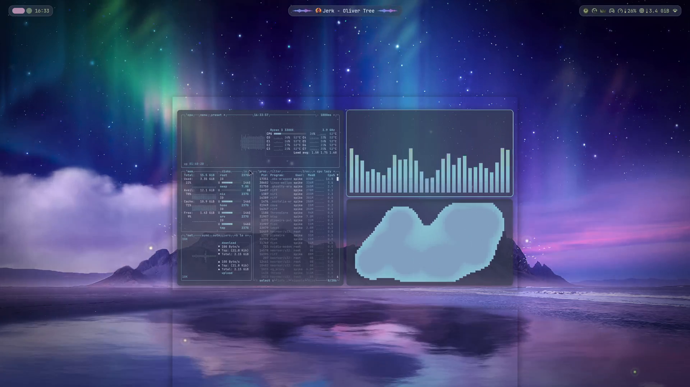
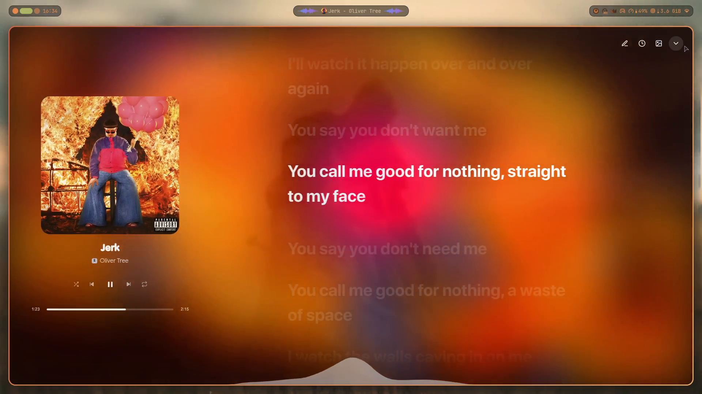
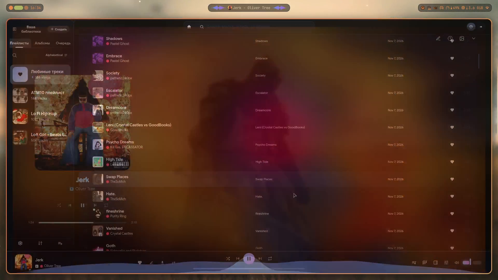

# Spike-dotfiles 🌌

<div align="center">

[](https://nixos.org/)
[](https://github.com/YaLTeR/niri)
[](https://github.com/noctalia-dev/noctalia)
[](https://ghostty.org/)
[](https://nixos.wiki/wiki/Flakes)
<br/>
[](https://github.com/triplespike/Spike-dotfiles/stargazers)
[](https://github.com/triplespike/Spike-dotfiles/network/members)
[](https://github.com/triplespike/Spike-dotfiles/commits/master)
[](LICENSE)
[](https://www.reddit.com/r/unixporn/comments/1xsxlpn/niri_celebrating_100_days_of_nixos_x_noctalia/)

*A dark cosmic / cyberpunk daily-driver rice on NixOS featuring the Niri scroll-compositor, Noctalia shell, dynamic on-the-fly theme switching, and acrylic blur.*

<br/>

<video src="https://github.com/triplespike/Spike-dotfiles/raw/master/assets/showcase.mp4" controls="controls" width="100%" poster="assets/screenshots/01_desktop.png">
  <a href="assets/showcase.mp4">▶️ Watch showcase video</a>
</video>

<br/>

[](assets/showcase.mp4)

<sub>🎬 **[▶️ Смотреть полное 1080p 60fps видео со звуком](assets/showcase.mp4)** (Oliver Tree — Jerk) • [Reddit Discussion](https://www.reddit.com/r/unixporn/comments/1xsxlpn/niri_celebrating_100_days_of_nixos_x_noctalia/)</sub>

</div>

---

> [!WARNING]
> ### ⚠️ Please Read Before Using!
> 
> * **Hardware-Specific Environment:** These dotfiles are specifically tuned for an **NVIDIA GPU** (proprietary drivers + Wayland buffer limits), AMD CPU, and a single 1080p @ 75Hz display.
> * **DO NOT blindly run `nixos-rebuild switch`:** This repository is **NOT an automated installer** or a universal turn-key OS template. Applying someone else's system configuration directly onto your machine can break your boot, display drivers, or graphical session.
> * **No Warranty & No Tech Support:** Everything here is provided strictly **AS-IS**. I take zero responsibility for broken setups, and I cannot provide personal tech support or triage GitHub issues for different hardware or distributions.
> * **Recommended Approach — Cherry-pick! 🍒:** The best way to use these dotfiles is to browse the configs, take inspiration, and cherry-pick what you like (Dynamic theme selector, Riff player derivation, Noctalia capsule blur, Niri keybindings, Ghostty/Fish styling, or Fastfetch art) into your own existing system!

---

## ✨ Highlights

* **Scrollable Tiling:** Fluid infinite horizontal canvas with dynamic column resizing and gesture physics via [Niri](https://github.com/YaLTeR/niri).
* **Dynamic Theme Switcher (`Mod + Shift + T`):** Instant on-the-fly theme switching (Nord Aurora, Catppuccin Mocha, Cyberpunk 2077, Medieval Grim, Shardscapes, Nullscapes). Swaps wallpapers, Ghostty terminal palettes, and Noctalia styling synchronously without rebuilds.
* **Packaged Riff Player (`pkgs/riff.nix`):** Custom Nix derivation for [Riff](https://github.com/rootscripts/riff) using `appimageTools`, configured with native Niri acrylic background blur and synchronized karaoke lyrics.
* **Capsule Blur Patch:** Native C++ blur patch for the [Noctalia](https://github.com/noctalia-dev/noctalia) shell bar applied declaratively via `overrideAttrs`.
* **Direct Scanout Pipeline:** Tailored window rules for fullscreen applications to enable uninhibited direct scanout with zero compositor overhead.
* **NVIDIA Wayland Stability:** Configured driver buffer limits eliminating stutter and frame pacing issues.
* **Declarative Flake:** Fully reproducible NixOS + Home Manager setup with atomic rollbacks.

---

## 📸 Screenshots Gallery

<details open>
<summary><b>Click to expand / collapse screenshots</b></summary>
<br/>

| Clean Desktop (Aurora Wallpaper & Noctalia Bar) | Noctalia Media & Quick Controls |
| :---: | :---: |
| [](assets/screenshots/01_desktop.png) | [](assets/screenshots/02_control_center.png) |

| Ghostty & Fastfetch (100 Days Milestone) | Cava Audio Visualizer & Btop |
| :---: | :---: |
| [](assets/screenshots/03_terminal.png) | [](assets/screenshots/04_cava_btop.png) |

| Dynamic Theme Selector (`Mod + Shift + T`) | Riff Music Player (Synced Lyrics & Blur) |
| :---: | :---: |
| [](assets/screenshots/05_theme_switcher.png) | [](assets/screenshots/06_riff_lyrics.png) |

<div align="center">

### Noctalia App Launcher (`Mod + D`)
[](assets/screenshots/07_launcher.png)

</div>

</details>

---

## 🎨 Aesthetic & Rice Overview

| Component | Software / Details |
| :--- | :--- |
| **OS** | [NixOS](https://nixos.org/) (26.11 Unstable, Linux Zen kernel) |
| **Compositor** | [Niri](https://github.com/YaLTeR/niri) (Scrollable-tiling Wayland compositor) |
| **Shell & Bar** | [Noctalia](https://github.com/noctalia-dev/noctalia) (Custom C++ capsule blur patch included) |
| **Terminal** | [Ghostty](https://ghostty.org/) (Dynamic palettes matching system themes) |
| **Shell** | [Fish](https://fishshell.com/) + [Starship](https://starship.rs/) prompt |
| **Fetch** | [Fastfetch](https://github.com/fastfetch-cli/fastfetch) with bundled art (`assets/fastfetch/Easy.png`) |
| **Music Player** | [Riff](https://github.com/rootscripts/riff) (Custom Nix derivation, synced lyrics, acrylic blur) |
| **Theme Selector**| Rofi theme menu (`theme-selector.rasi`) & Python/Libadwaita GUI (`theme-menu-gui.py`) |
| **Browser** | [Zen Browser](https://zen-browser.app/) |
| **Screenshots** | [Satty](https://github.com/gabm/Satty) with instant screen freeze via Noctalia screencopy |
| **Display Manager** | SDDM with [Astronaut theme](https://github.com/keyitdev/sddm-astronaut-theme) (Black Hole preset) |
| **Bootloader** | GRUB with [HyperFluent theme](https://github.com/Coopydood/HyperFluent-GRUB-Theme) |
| **Audio** | PipeWire + WirePlumber |
| **Cursor** | Catppuccin Mocha Dark |

---

## ⌨️ Keybindings Cheatsheet

| Keybinding | Action |
| :--- | :--- |
| `Mod + Return` | Spawn Terminal ([Ghostty](https://ghostty.org/)) |
| `Mod + D` | Application Launcher ([Noctalia](https://github.com/noctalia-dev/noctalia)) |
| `Mod + Shift + T` | **Theme Selector** (Instant dynamic wallpaper & palette switch) |
| `Mod + M` | **Riff Music Player** (Toggle visibility / launch) |
| `Mod + B` | Web Browser ([Zen Browser](https://zen-browser.app/)) |
| `Mod + Shift + B` | Secondary Browser (Firefox) |
| `Mod + E` | File Manager ([Dolphin](https://apps.kde.org/dolphin/)) |
| `Mod + Q` | Close Active Window |
| `Mod + Space` | Toggle Keyboard Layout (`US` ↔ `RU`) |
| `Print` | Capture Screenshot (Freeze screen + [Satty](https://github.com/gabm/Satty) annotation) |
| `F9` | Toggle OBS Studio Recording (Silent WebSocket command) |
| `F8` | Toggle OBS Studio Pause |
| `Mod + H / L` | Focus Column Left / Right |
| `Mod + J / K` | Focus Window Down / Up |
| `Mod + Shift + H / L` | Move Column Left / Right |
| `Mod + Shift + J / K` | Move Window Down / Up |
| `Mod + R` | Switch Preset Column Width (e.g. 50% ↔ 75% ↔ 100%) |
| `Mod + F` | Maximize Column |
| `Mod + Shift + F` | Fullscreen Window (Direct Scanout) |
| `Mod + 1..9` | Switch to Workspace 1–9 |
| `Mod + Shift + 1..9`| Move Focused Window to Workspace 1–9 |

---

## 🚀 Structure & How to Explore

```
Spike-dotfiles/
├── assets/
│   ├── fastfetch/Easy.png      # Fastfetch anime art logo
│   ├── screenshots/            # 1080p showcase screenshots
│   ├── wallpapers/             # Static and animated video wallpapers
│   ├── showcase.webp           # Beat-drop theme switcher animated preview
│   └── showcase.mp4            # Full 1080p 60fps showcase video with audio
├── pkgs/
│   └── riff.nix                # Custom Nix derivation for Riff music player
├── scripts/
│   └── theme-menu-gui.py       # GTK4 / Libadwaita theme switcher interface
├── config/
│   └── theme-manager/presets.json # Theme presets, palettes, and wallpaper mappings
├── patches/
│   └── noctalia-bar-capsule-blur.patch # C++ patch for rounded capsule blur in Noctalia
├── theme-selector.rasi         # Custom Rofi theme switcher stylesheet
├── niri.kdl                    # Niri scroll-compositor window rules and binds
├── configuration.nix           # System-level NixOS configuration
├── flake.nix                   # Flake inputs & multi-host system declaration
├── hardware-configuration.nix.example # Hardware config template
├── home.nix                    # Home Manager declaration: Niri, Noctalia, Themes, Ghostty
├── LICENSE                     # MIT License
└── README.md                   # Project documentation
```

---

## ⭐ Support & Stargazers

If you found this rice aesthetically inspiring or learned something useful from the Nix Flake configs:
* **Give this repository a Star ⭐** — it helps other NixOS and Niri ricers discover this setup!
* Feel free to open a discussion or fork it for your own machine.

[](https://star-history.com/#triplespike/Spike-dotfiles&Date)

---

## 📜 License

This project is licensed under the [MIT License](LICENSE).
